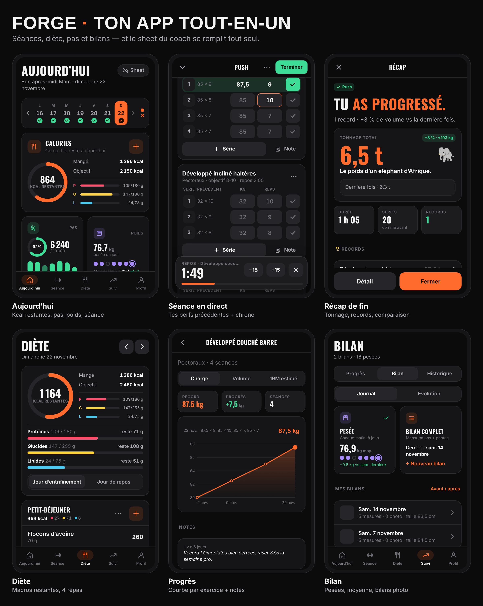

# FORGE — séances, diète, pas et bilans dans une seule app

App web installable sur iPhone (PWA) : elle s'ouvre en plein écran depuis l'écran d'accueil et marche hors connexion à la salle.



| Module | Ce que ça fait |
| --- | --- |
| **Séance** | Programmes (Push, Pull…), séance en direct avec **tes perfs de la dernière fois sur chaque série**, chrono de repos auto (bip, vibration, −15 / +15 s), échauffement / dégressive / échec, supersets, cardio, exercice de remplacement si la machine est prise, notes. Récap de fin : tonnage, records battus, comparaison avec la dernière fois. |
| **Diète** | Calories et macros **restantes** (objectifs différents jour d'entraînement / repos possibles), 4 repas, base d'aliments courants intégrée, recherche et **scan code-barres** Open Food Facts, ajout rapide, aliments et recettes perso, favoris, copie du repas de la veille. |
| **Pas** | Pas du jour et 7 derniers jours, envoyés par un **Raccourci iOS** depuis Santé (iPhone + Apple Watch), ou saisis à la main. |
| **Ressenti du jour** | Sommeil (durée + qualité), énergie, motivation, satiété, digestion, eau et note : les échelles du « Suivi journalier » du coach. |
| **Suivi** | Courbe par exercice (charge, volume, 1RM estimé), tonnage et séries par muscle sur 7 jours, historique. Pesée quotidienne avec **moyenne de la semaine**, bilan hebdo (mensurations, photos face/profil/dos), avant / après. |
| **Google Sheets** | Tout part dans **ton** Google Sheet (onglets Jours, Repas, Séances, Détail séries, Pas, Bilans) puis le script remplit **le sheet du coach** (Suivi journalier + Entraînement). |

Les données vivent sur le téléphone (IndexedDB). Sauvegarde / restauration en JSON dans Profil.

---

## 1. Mettre l'app en ligne (Vercel, 5 min)

Le dossier `forge/` est un projet Vite autonome, à côté d'Atlas Intel (rien n'est modifié côté Atlas Intel).

1. Sur [vercel.com](https://vercel.com) : **Add New → Project** → importe le repo `atlas-intel`.
2. **Root Directory** : clique sur *Edit* et choisis `forge`. Vercel détecte Vite tout seul (build `npm run build`, sortie `dist`).
3. **Deploy**. Tu obtiens une URL du type `forge-xxx.vercel.app`.

> Vercel déploie la branche `main`. Tant que le code est sur une autre branche, fusionne-la dans `main` (ou change la *Production Branch* dans Settings → Git).

## 2. L'installer sur l'iPhone

Ouvre l'URL dans **Safari** → bouton **Partager** → **Sur l'écran d'accueil**. Ouvre toujours Forge depuis cette icône : c'est là que tes données sont stockées (Safari et l'icône ne partagent pas les mêmes données).

## 3. Relier Google Sheets (une fois, idéalement sur ordinateur)

1. Crée un Google Sheet vide (`sheets.new`), par ex. **Forge – Suivi**.
2. **Extensions → Apps Script**, efface le code et colle le script copié depuis l'app (Profil → Google Sheets → Guide → Copier le script) : il contient déjà ton jeton et le lien du sheet du coach. Sinon, colle [`apps-script/Code.gs`](apps-script/Code.gs) et remplace `COLLE_TON_JETON_ICI` par ton jeton.
3. **Déployer → Nouveau déploiement → Application Web** — Exécuter en tant que : **Moi** — Accès : **Tout le monde** → autorise.
4. Copie l'URL `…/exec` dans l'app → **Tester et relier**. L'app affiche ce qu'elle a trouvé chez le coach (Suivi journalier ✓, semaines de l'onglet Entraînement).

L'app envoie ensuite automatiquement : au démarrage, au retour dans l'app et quelques secondes après chaque modification (jamais pendant une séance en cours). Hors ligne, les modifications attendent le retour du réseau.

## 4. Les pas automatiques (Raccourci iOS)

Une app web ne peut pas lire Santé : un Raccourci le fait. Le pas-à-pas complet (avec l'URL à coller, jeton inclus) est dans l'app : **Profil → Pas automatiques**. En résumé :

`Rechercher des échantillons de santé (Nombre de pas, aujourd'hui, regrouper par jour)` → `Calculer des statistiques (Somme)` → `Obtenir le contenu de l'URL` : `https://script.google.com/…/exec?action=pas&token=TON_JETON&steps=[Statistiques]`

Puis 2 ou 3 automatisations **Heure de la journée** (13 h, 19 h, 22 h 30) en « Exécuter immédiatement ». iOS bloque Santé quand l'iPhone est verrouillé : un envoi raté est rattrapé par le suivant, ou via le bouton **Envoyer mes pas** de l'app.

## 5. Le sheet du coach

Le script est réglé pour le sheet du coach (`COACH_MAPPING` dans `Code.gs`) :

| Onglet du coach | Ce que l'app remplit |
| --- | --- |
| **Suivi journalier** (une ligne par jour, dates en colonne C dès la ligne 11) | G poids · H sommeil (h, « 1 à 3 » si nuit courte) · I qualité du sommeil · K pas · L cardio (min) · M séance · O énergie · P motivation · Q satiété · R digestion · T calories · U/V/W protéines/glucides/lipides · X fibres · Y eau · AC notes |
| **Entraînement** (12 blocs « Semaine N » côte à côte, bandeaux LUNDI / MARDI / JEUDI / VENDREDI, exercices en colonne B) | Dans le bloc de la semaine en cours, sur la ligne de l'exercice : « POIDS X REPS » au format `55kg x 10 ; 50kg x 11`, « Progressé en POIDS/ CHARGE ? » (OUI / Maintenu / Regressé, ou Nouvel exo) et « Douleurs/ Notes » |
| **Nutrition** (lecture seule) | Objectifs Jour ON / Jour off et pas, repris dans l'app à l'import |

- Les lignes « Moyenne », les formules et les colonnes du coach (Nutrition Phase…) ne sont jamais touchées ; une case n'est écrite que si l'app a une valeur.
- La semaine se retrouve grâce à « Semaine N » (colonne B du suivi journalier) : la séance du 23 novembre va dans le bloc « Semaine 8 ». Une semaine absente de l'onglet Entraînement (après la 12e) est signalée dans l'app.
- Un exercice hors programme n'est pas ajouté chez le coach (la colonne Exercise est la sienne) : l'app le signale, et il reste dans ton propre sheet.
- L'onglet **Checkins** (questionnaire de la semaine) reste à remplir à la main. Les photos du bilan s'envoient depuis l'app (Suivi → Bilan → « Envoyer les photos au coach », via WhatsApp ou Messages).

Mise en route :

1. Dans l'app, **Profil → Google Sheets** : colle le lien du sheet du coach (il doit te l'avoir partagé en modification).
2. Guide → **Copier le script** : il contient déjà ton jeton et ce lien. Colle-le dans Apps Script, déploie (voir 3).
3. **Importer le programme du coach** : les séances (Upper A = lundi, Lower A = mardi, Upper B = jeudi, Lower B = vendredi) sont créées avec les noms exacts, les séries, reps et RIR de la semaine en cours ; toutes les semaines déjà remplies deviennent ton historique (colonne « Précédent », courbes) ; les objectifs de l'onglet Nutrition remplacent les tiens (jour ON / jour off, 15 000 pas).
4. Chaque jour : pesée, **Ressenti du jour** (sommeil, énergie, motivation, satiété, digestion, eau, note), diète, séance. Tout part tout seul.

La fonction `diagnosticCoach()` (à lancer depuis l'éditeur Apps Script) affiche ce que le script a repéré : ligne du jour, numéro de semaine, blocs et jours de l'onglet Entraînement.

---

## Développement

```bash
cd forge
npm install
npm run dev        # serveur local
npm test           # tests : calculs, scan, import du programme, script Apps Script sur une réplique du sheet du coach
npm run typecheck
npm run build      # sortie dans dist/
```

- React 19 + TypeScript + Vite 8, `vite-plugin-pwa` (hors ligne), Zustand + IndexedDB (`idb-keyval`).
- Scan : `BarcodeDetector` natif, sinon `barcode-detector` (ZXing en WebAssembly, servi par l'app).
- Aliments du commerce : [Open Food Facts](https://world.openfoodfacts.org) (base libre). Aliments génériques : valeurs moyennes type Ciqual, pour 100 g.
- `scripts/render-icons.mjs` régénère les icônes à partir de `public/favicon.svg`.

## Limites connues

- Le bip de fin de repos ne sonne que si l'app est ouverte (l'écran reste allumé pendant la séance). Sur iPhone, la vibration demande iOS 18+.
- La recherche Open Food Facts et le scan demandent du réseau ; la base intégrée, elle, marche hors ligne.
- Les photos de bilan restent sur le téléphone (incluses dans les données locales, pas dans l'export JSON).
